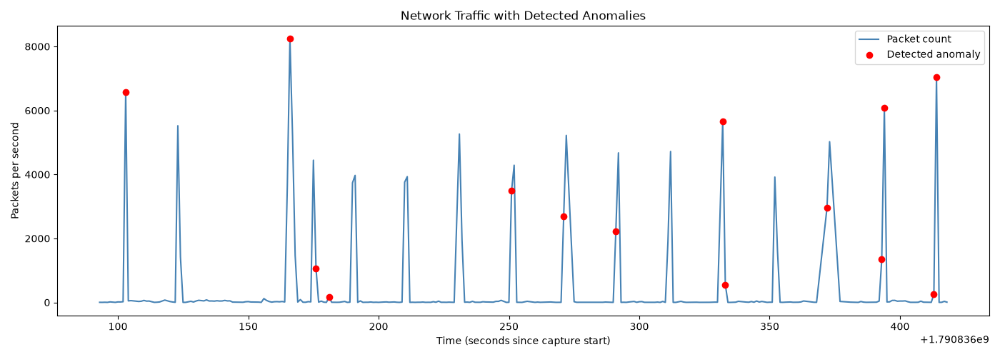

# Network Traffic Anomaly Detector

Captures real network traffic, extracts time-windowed performance features, and applies unsupervised machine learning to automatically detect abnormal traffic bursts — without manually defining thresholds.

## Status

- ✅ **Packet capture & parsing** — real traffic captured with Wireshark, parsed with PyShark
- ✅ **Feature extraction** — packets-per-second and bytes-per-second across 273 one-second windows
- ✅ **Anomaly detection** — Isolation Forest model, unsupervised
- ✅ **Visualization** — traffic timeline with detected anomalies highlighted

## Methodology

1. Captured ~5 minutes of real network traffic (browsing, video, idle periods) using Wireshark
2. Parsed the capture with PyShark, extracting per-packet timestamp, size, and protocol
3. Aggregated packets into 1-second windows, computing packet count and total bytes per window
4. Trained an Isolation Forest model (scikit-learn) on these two features to identify windows that deviate from the dominant traffic pattern
5. Verified the model correctly flagged a genuine, manually-identified traffic burst (6,569 packets / 7.65MB in a single second, driven by video/large content load) as the top anomaly

## Results

Out of 273 one-second windows, the model flagged 14 as anomalous (contamination=0.05), each corresponding to a real traffic burst — not noise. The real anomaly identified during manual data inspection was confirmed as the model's top-ranked detection.



## Key Findings

- A single second-level view of raw packet/byte counts is sufficient to separate "normal" browsing-level traffic (tens of packets per second) from burst events (thousands of packets per second) without any manual threshold-setting
- The `contamination` parameter directly controls detection sensitivity: with a fixed 5% quota, some visually similar traffic spikes were not flagged simply because the quota was already met by other points — this is a sensitivity/threshold tradeoff, not a model failure, and shows the importance of understanding the parameter's real meaning rather than treating it as a free dial
- Unsupervised detection (Isolation Forest) requires no labeled "anomalous" examples — it works by isolating points that are easy to separate from the dense cluster of normal data via random splits, which matched real traffic bursts in this dataset

## Build & Run

```bash
python3 -m venv venv
source venv/bin/activate
pip install pyshark pandas scikit-learn matplotlib
python3 parse_capture.py
```

## Tech Stack

Python, PyShark, pandas, scikit-learn (Isolation Forest), matplotlib

## Planned Extensions

- Use raw anomaly scores instead of a fixed contamination quota, for more granular, tunable sensitivity
- Expand features beyond packet/byte count (e.g., protocol distribution, unique destination count per window)
- Synthetic anomaly injection for controlled precision/recall validation